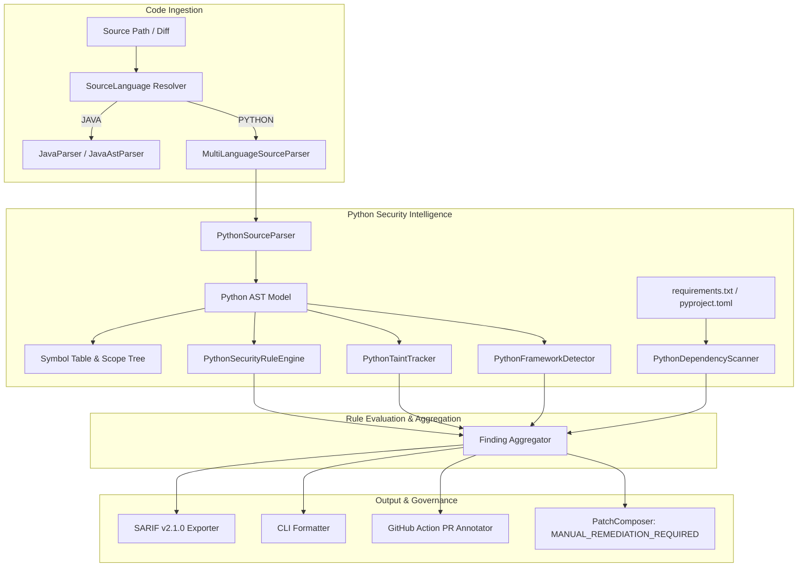
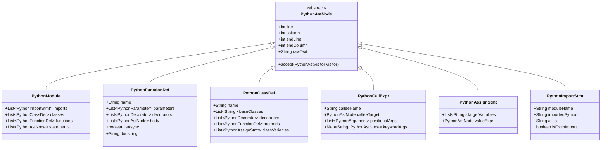

# SentinelPR Python Security Intelligence Architecture

## 1. Executive Summary & Vision

SentinelPR Phase 5 transitions SentinelPR from a Java-first code security copilot into an enterprise multi-language static analysis and security intelligence platform. While Phase 4B provided non-Java routing, fail-safe barriers, and baseline lexical pattern matching, Phase 5 introduces **production-grade Python AST parsing, structural source modeling, intra-procedural taint tracking, framework intelligence, dependency analysis, and dedicated benchmark governance**.

### Core Tenets
1. **Zero External Runtime Dependency**: Pure Java AST parsing and tokenization ensure deterministic analysis across local environments, CI/CD runners, and air-gapped systems without requiring Python, CPython, or external virtual environments.
2. **Traceable Structural Evidence**: Replace naive substring and regex heuristics with concrete AST nodes, exact line/column spans, call hierarchies, and dataflow chains.
3. **Strict Remediation Boundary**: All non-Java findings are explicitly marked `MANUAL_REMEDIATION_REQUIRED` until safe, verified AST rewrite engines are implemented. No synthetic or invalid patches are generated.
4. **Zero Regression for Java Baseline**: All existing Java security rules, taint tracking, and the 108-case Java benchmark baseline ($TP=62, TN=46, FP=0, FN=0$) remain preserved and undisturbed.

---

## 2. High-Level Architecture & Component Interaction

---

## 3. Pure-Java Python AST & Intermediate Representation (IR)

The Python AST hierarchy resides under `com.sentinelpr.core.analysis.multilang.python.ast`:

### Parsing Pipeline
`PythonSourceParser` tokenizes and parses Python source files into an AST:
1. **Lexical Tokenization**: Indentation and dedentation tokens (`INDENT`, `DEDENT`), string literals (single, double, triple-quoted raw and f-strings), operators, comments, and identifiers.
2. **Structural Statement Parser**: Extracts imports (`import x`, `from x import y as z`), decorators (`@app.route(...)`), function headers (`def`, `async def`), class definitions (`class Foo(Bar):`), conditionals (`if`, `elif`, `else`), loops (`for`, `while`), exception blocks (`try`, `except Exception as e`, `finally`), assignments (`x = y`, `a, b = c`), and returns.
3. **Expression Parser**: Identifies call expressions (`obj.method(a, b=c)`), subscripting (`request.args['id']`), binary operations (`+`, `%`), formatting expressions (`f"..."`, `format(...)`), and literal values.

---

## 4. Intra-Procedural Taint Analysis (`PythonTaintTracker`)

To detect complex vulnerabilities while minimizing false positives, SentinelPR implements function-local taint analysis:

1. **Source Identification**:
   - Web framework inputs: `request.args`, `request.form`, `request.json`, `request.GET`, `request.POST`, `request.query_params`, `request.body`.
   - Function parameters of decorated entry-points (Flask routes, Django views, FastAPI endpoints).
   - System inputs: `sys.argv`, `os.environ.get(...)`.
2. **Taint Propagation**:
   - Tracks assignments (`tainted_var = request.args.get('id')`).
   - String concatenation and interpolation (`sql = "SELECT * FROM users WHERE id = " + tainted_var`, `f"...{tainted_var}..."`).
   - Subscript access and method returns.
3. **Sanitizers & Neutralizers**:
   - SQL: Parameterized query tuples/lists (`cursor.execute(sql, (param,))`).
   - Command Execution: `shlex.quote(...)`, `subprocess.run([...], shell=False)`.
   - Path Traversal: `os.path.realpath(...)`, `os.path.commonpath(...)`, `os.path.abspath(...)` checked against trusted root.
   - SSRF: Domain allowlisting checks (`if host in ALLOWED_HOSTS:`).
4. **Sink Identification**:
   - SQLi: `cursor.execute`, `session.execute`, `engine.execute`.
   - Command Injection: `os.system`, `os.popen`, `subprocess.Popen(..., shell=True)`.
   - Code Eval: `eval()`, `exec()`, `input()`.
   - Deserialization: `pickle.loads`, `_pickle.loads`, `yaml.load(..., Loader=UnsafeLoader)`.
   - Path Traversal: `open()`, `os.remove()`, `os.rmdir()`, `shutil.rmtree()`.
   - SSRF: `requests.get()`, `requests.post()`, `httpx.get()`, `urllib.request.urlopen()`.

---

## 5. Framework Intelligence

### Flask
- Detects `@app.route(...)`, `@blueprint.route(...)` and HTTP method constraints.
- Identifies unescaped HTML rendering via `render_template_string(...)` and `flask.Markup(...)` (XSS).
- Analyzes configuration flags: `app.config['DEBUG'] = True`, `SESSION_COOKIE_HTTPONLY = False`.

### Django
- Detects `views.py` functions and `View` subclasses.
- Inspects query construction: `.raw(...)`, `.extra(...)`, dynamic queries bypassing the ORM.
- Analyzes `mark_safe(...)` usage resulting in Cross-Site Scripting.
- Analyzes `settings.py` security flags: `DEBUG = True`, `ALLOWED_HOSTS = ['*']`, `SESSION_COOKIE_SECURE = False`.

### FastAPI
- Identifies `@router.get`, `@router.post`, etc.
- Recognizes query parameters, path parameters, and request bodies (`Query(...)`, `Path(...)`, `Body(...)`).
- Analyzes CORS middleware configurations (`CORSMiddleware` with `allow_origins=["*"]`).

---

## 6. Dependency & Lockfile Security Intelligence

`PythonDependencyScanner` inspects Python project metadata across standard manifest formats:
- `requirements.txt`
- `pyproject.toml`
- `Pipfile` / `Pipfile.lock`
- `poetry.lock`

It evaluates pinned package versions against a curated database of critical/high security advisories (e.g. vulnerable versions of `urllib3`, `requests`, `Django`, `Flask`, `Pillow`, `cryptography`, `PyYAML`).

---

## 7. Python Security Benchmark Suite & Quality Metrics

To ensure strict engineering rigor, SentinelPR introduces a dedicated Python benchmark suite located in `benchmark/cases/python/`.

### Confusion Matrix Target:
- **True Positives (TP)**: 100% of verified vulnerable fixtures detected.
- **False Positives (FP)**: 0% false alarms on idiomatic, safe fixtures.
- **True Negatives (TN)**: 100% of properly sanitized or safe fixtures pass without finding.
- **False Negatives (FN)**: 0 missed vulnerabilities.

---

## 8. Remediation Boundary & Governance

In compliance with SentinelPR core security principles:
- **Java**: Automatic unified diff generation and regression verification remain active.
- **Python**: Findings are marked with `MANUAL_REMEDIATION_REQUIRED`. SentinelPR generates detailed remediation explanations, code examples, and mitigation guidelines in findings, but does **not** generate synthetic or unverified AST patches.
